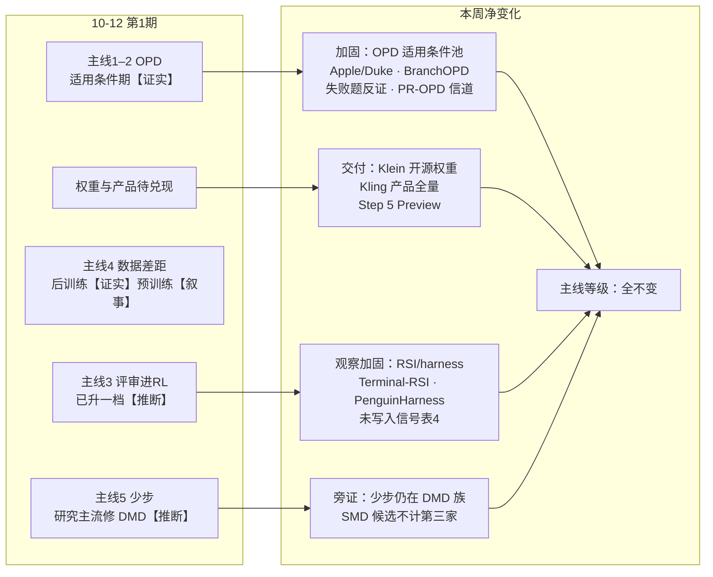
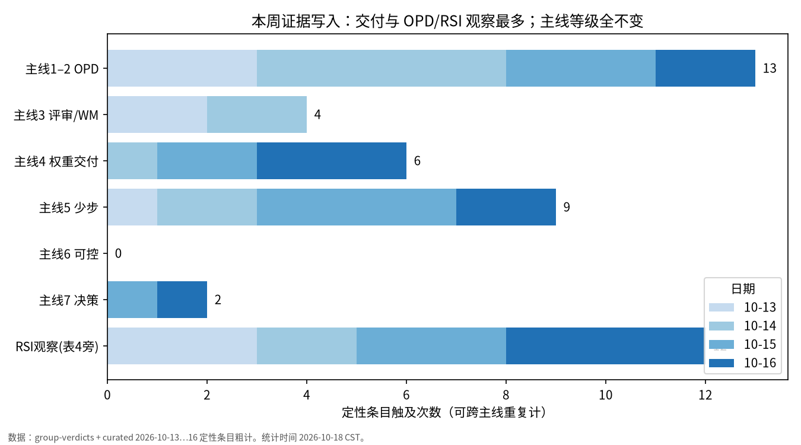
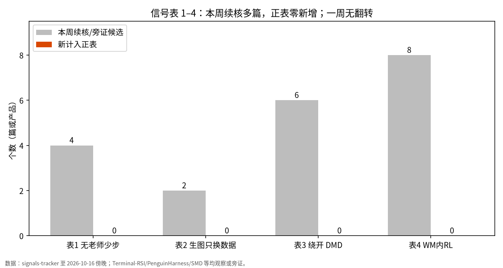
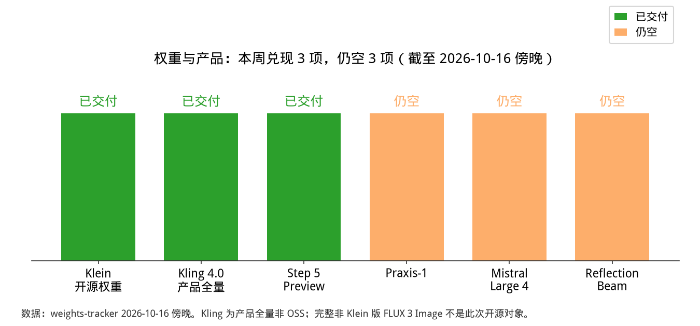

# AI 前沿趋势周报 · 2026-10-18（第 2 期）

**一句话结论：主线无升级、无降级、无新增【推断，对照趋势定性】；FLUX 3 Image Klein 与 Kling 4.0 属权重/产品交付【证实】；PR-OPD 把 OPD 监督从词概率改到隐状态【证实，单篇】；Terminal-RSI / LlamaFactory RSI / PenguinHarness 挂观察，未写入信号表 4【证实】；信号表 1–4 一周无翻转【证实】。**

- 对比基线：2026-10-12 第 1 期周报。
- 覆盖时间：2026-10-13 至 2026-10-18（Asia/Shanghai）。10-17 / 10-18 无新日报或趋势定性，看板 archive_date 仍停在 2026-10-16。
- 标注：【证实】有对照实验或官方一手；【推断】是我们的归纳；【未证实】是传闻或缺独立来源；【叙事】是常见说法。

## 一周脉络

## 关键图

## 本周变化

### 不变：七条主线等级相对第 1 期均无升降【推断】
- 前沿趋势分析 10-13 至 10-16 各班次结论均为「主线无升级、无降级、无新增」。
- 看板 `state.json`（built_at 2026-10-18 10:41 CST）结论句与 10-16 日报一致。
- 信号表 1–4 无翻转（signals-tracker 最近更新 2026-10-16 傍晚）。

### 加固：主线 1–2「OPD 适用条件」池扩大，等级不变【证实（多篇单 seed）】
- **Apple/Duke（2610.04272）**：调好的 SFT 与多教师 OPD，域内四种方法最大相差 3.5/4.6 个百分点，无一致优势；MOPD 训练算力是 SFT 的 14.8×/23.1×（Qwen3-8B 两组任务）【证实】。大教师时是取舍：SFT 换域内、OPD 守域外【推断】。
- **BranchOPD（2610.13481）**：相对 Vanilla OPD，数学 avg@16 +18.55pp、ALFWorld 均值 +13.8【证实，作者自报】。只改不确定点分支采样；挂适用条件观察，不进正表。
- **OPD 失败题反证（2610.18011）+ RC-OPD（2610.03515）**：失败题上训会掉点；根因修补再蒸。方向性反证，不引幅度进主结论。
- **PR-OPD（2609.36642）**：事后技能对齐隐藏状态，而非词概率。Qwen2.5-3B 相对 GRPO：ALFWorld All +4.7pp（66.4→71.1），WebShop Acc +11.7pp（55.5→67.2）【证实，表 1】。技能在场时改动的采样 token 概率不足四分之一，隐状态改动超过八成【证实，作者自报】。进 OPD 适用条件池「信道：隐状态 vs token」。
- 同窗续热：Semi-OPD、Critique-OPD、MM-OPD、ActionOPD、Reality Check（Agent RL 自蒸馏无一稳超 GRPO）——均作观察，主线等级不变。
- 「先 SFT 再 OPD」顺序冲突仍开放（Semi-OPD vs Salesforce 稿）；Apple/Duke 未测该顺序。

### 交付：主线 4 权重/产品侧部分兑现，不进信号表【证实】
| 模型 | 本周状态 | 证据 |
|---|---|---|
| FLUX 3 Image Klein（5.6B） | **开源权重交付**（约 10-15/16） | [BFL 博客](https://bfl.ai/blog/flux-3-image-klein) · [HF](https://huggingface.co/black-forest-labs/flux-3-image-klein) |
| Kling 4.0 | **产品全量**（非 OSS；API/HDR 仍 coming soon） | 官方 release history 2026-10-15 |
| Step 5 Preview | **开源权重交付**（约 10-15） | HF `stepfun-ai/Step-5-Preview` 及 BF16/NVFP4 |
| Praxis-1 | 仍空 | HF runwayml 空 |
| Mistral Large 4 | 仍空 | 承诺约 10/27–10/31 |
| Reflection Beam | 仍空 | ReflectionAI org 空 |

- 同窗开源/产品但不改训练主线：Gemini 4 Argon GA（10-14）、Liquid LFM2.5-24B-A2B、Ling-3.1-flash、Muse Spark Open、Nemotron 3.5 Super VL、Liquid d1-ultra。
- 完整非-Klein FLUX 3 Image 不是此次开源对象【官方博客口径】。
- 生图预训练「只换数据」仍【叙事】；GPT Image 2.5 无新一手。

### 新增观察（主线等级不变）：RSI / harness 权重环扩窗，信号表 4 仍空【证实】
- **Terminal-RSI（2610.22192）**：终端 agent 交替 RSR+RPR 并更新策略权重；可验证终端环境，但非 learned WM 内 RL → **挂 RSI/harness 观察，未写入信号表 4**。
- **LlamaFactory RSI / PenguinHarness**（主仓 [Prism-Shadow/penguin-harness](https://github.com/Prism-Shadow/penguin-harness)）：README 明确 model 固定、演进 harness；无 WM 内 RL 留存训权重 → 观察，主线等级不变。
- **ClawLoop（2610.14118）**：会 SFT/GRPO 更新权重并多轮留存（SkillsBench 46.3→57.2 作者自报）【证实】，但是 harness 沙箱自进化，不是 WM 内 RL → 未写入信号表 4。
- 旁证窗：RSI-Nav、AdaRSI、SwarmRSI、VideoHarness-SRSI、MetaShare、RSIFlow、MetaExp。
- 表 4 升级条件未变：大厂写清「可验证世界里训策略权重且留存进下一轮」。基线仍 RSI-Anything / RIWANav（结构样本，主线等级未变）。

### 旁证：主线 5 少步续热，仍无第三家绕开 DMD【推断】
- **SMD（2610.18472）**：少步「绕开 DMD」候选，**不计第三家**（π-Flow、PTD 仍是仅有两家）。
- **Glance Forcing（2610.20220）**：单条 PF-ODE + Slow/Fast LoRA；VBench 84.04→84.22【作者自报】→ 旁证。
- **Speculative Forcing（2610.22347） / RepForcing（2610.20111）**：投机/表征初始化；RepForcing 仍接 asymmetric DMD（VBench Total 84.04→84.66【作者自报】）→ 旁证，不进正表。
- **DMAD** 续热：仍在 DMD 族。
- Data-Space Iteration / PVD / RY-DMD：结构旁证，主线等级不变。

### 撤回
- 无。

### 不变（细项）
- 主线 3「评审进 RL」：等级保持第 1 期升档后位置；本周无纯偏好对照补强。
- 主线 6「可控」、主线 7「决策模型」：Liquid d1-ultra、Jev 决策头为产品/品类续热，不改档。
- Hub 趋势榜（10-15…10-18）：只记原值热度，不进主线、不写「值得学」推荐进周报结论。

## 重点方向命中

| 方向 | 本周命中 | 判定 |
|---|---|---|
| DMD/PDMD 少步 | Speculative Forcing、RepForcing、Glance Forcing、SMD、DMAD、Data-Space/PVD/RY-DMD | 旁证或候选；无第三家绕开 |
| batch RL | 看板 focus_hits 空 | 无新一手 |
| GPT Image 2.5 | 无 | 无新一手 |
| Qwen-Image | 无新对比 | 无 |
| VIEScore2 | 无新版本 | 无 |
| 后训练 / OPD | PR-OPD、BranchOPD、Apple/Duke、失败题反证、MM-OPD、ActionOPD、Agent-Reflex | 适用条件池加固 |
| 生图/生视频 | Klein 开源、Kling 产品全量 | 交付，不进信号表 |
| RSI | Terminal-RSI、PenguinHarness、RSI-Nav、ClawLoop 旁证 | 观察，未写入信号表 4 |

## 对照第 1 期「下周要盯」核对

| # | 上期信号 | 本周结果 |
|---|---|---|
| 1 | Step 5 权重（承诺 10-15） | **命中交付**；属产品/权重，未附可核后训练配方进主线 |
| 2 | Mistral Large 4、Reflection Beam 技术报告 | **落空**（仍空） |
| 3 | Optica 蒸成少步 | **无正式条目可核对**（本周未再见） |
| 4 | 代码世界当 RL 环境训权重 | **未触发**（表 4 仍空） |
| 5 | 扩散侧重叠率诊断 | **部分旁证**：PR-OPD 改信道（隐状态），非重叠率诊断 |
| 6 | 视频 RL 与纯偏好对照 | **未触发** |
| 7 | 生图预训练只换数据 | **未触发**（仍叙事） |
| 8 | Semi-OPD 与 SFT 热身冲突 | **仍开放** |

## 下周要盯的信号

1. **Praxis-1 / Mistral Large 4 / Reflection Beam**：任一附后训练配方，主线 1 可加独立来源。
2. **完整 FLUX 3 Image（非 Klein）** 开源与加速方法披露。
3. **信号表 4**：大厂写清「可验证世界 / learned WM 内 RL 训策略权重且留存」。
4. **少步第三家绕开 DMD**：SMD 类方法补独立复现或大厂上线。
5. **PR-OPD 式隐状态监督**在更大模型/多 seed 复现 → 主线 2 可升级。
6. **Semi-OPD vs SFT 热身**多 seed 复现。
7. **视频 RL × 纯偏好对照**（WorldAlign 类补齐）。

## 来源

- 一手论文（本周核对过摘要或看板定性引用）：[2609.36642 PR-OPD](https://arxiv.org/abs/2609.36642) · [2610.04272 Apple/Duke](https://arxiv.org/abs/2610.04272) · [2610.13481 BranchOPD](https://arxiv.org/abs/2610.13481) · [2610.18011 OPD 失败题](https://arxiv.org/abs/2610.18011) · [2610.22192 Terminal-RSI](https://arxiv.org/abs/2610.22192) · [2610.14118 ClawLoop](https://arxiv.org/abs/2610.14118) · [2610.18472 SMD](https://arxiv.org/abs/2610.18472) · [2610.20220 Glance Forcing](https://arxiv.org/abs/2610.20220) · [2610.22347 Speculative Forcing](https://arxiv.org/abs/2610.22347) · [2610.20111 RepForcing](https://arxiv.org/abs/2610.20111) · [2610.11291 Semi-OPD](https://arxiv.org/abs/2610.11291)（续热）
- 官方与权重：[BFL Klein 博客](https://bfl.ai/blog/flux-3-image-klein) · [HF flux-3-image-klein](https://huggingface.co/black-forest-labs/flux-3-image-klein) · [PenguinHarness](https://github.com/Prism-Shadow/penguin-harness) · Step-5-Preview HF · Gemini 4 Argon Google/DeepMind 官宣帖
- 内部定性：看板 state.json / group-verdicts.md / curated 2026-10-13…16；cluster-rated.latest.json；signals-tracker / weights-tracker（store digests）；ai-digest 日报 10-13…16；hub-trends digests 10-15…18
- 公开时间线：[AI 前沿趋势时间线](https://codyshen0000.github.io/ai-frontier-trends/timeline/) · 上期周报：[2026-10-12](https://codyshen0000.github.io/ai-frontier-trends/weekly/2026-10-12/)
