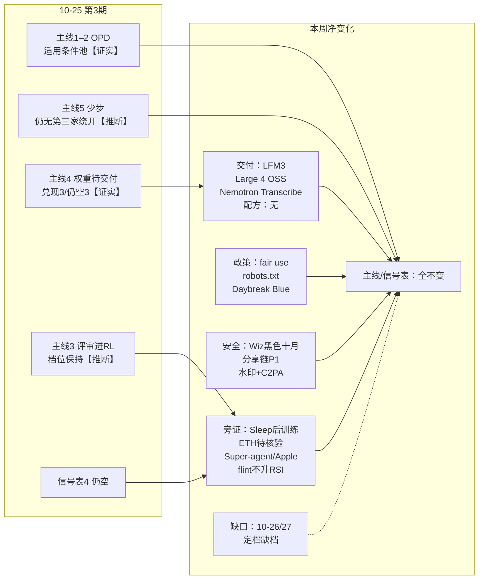
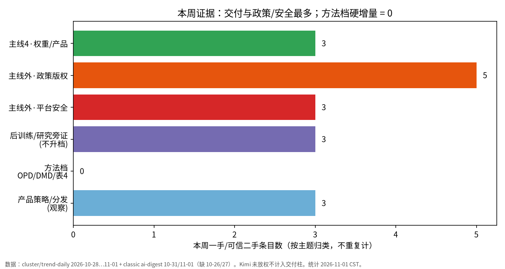
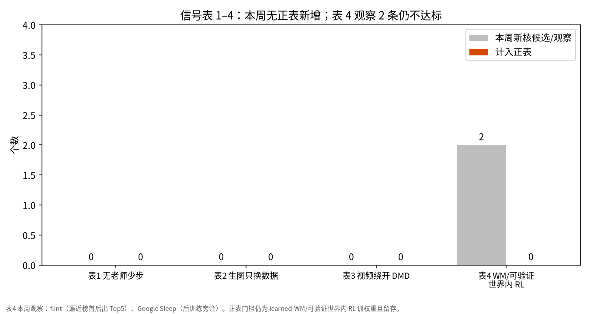
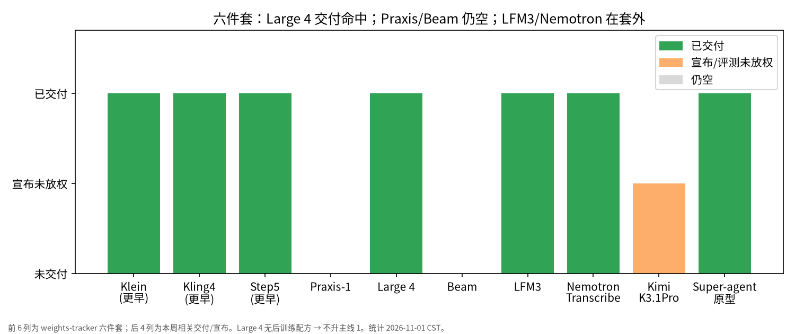

# AI 前沿趋势周报 · 2026-11-01（第 4 期）

**一句话结论：主线 1–5 / 信号表 1–4 无升级、无降级、无翻转【推断，相对 10-16 基线与第 3 期】；训练方法档沿用 2026-10-16【证实，定档 10-28…11-01 反复写「无升降档、无翻转」】；增量在权重/产品交付（LFM3、Mistral Large 4 OSS、Nemotron Transcribe）【证实】——Large 4 交付命中上期「下周要盯」但未见可核后训练配方、不升主线 1【证实】；政策·版权·数据控制成簇（fair use / robots.txt / Daybreak Blue）【证实】；平台安全成簇（Wiz 黑色十月、Parameter Labs 分享链 P1、Anthropic 水印+C2PA）【证实】；flint 曾逼近榜首后滑出 Top5，全程不升 RSI【证实】；10-26/27 定档例程失败缺档，覆盖不连续【证实】。**

- 对比基线：2026-10-25 第 3 期周报。
- 覆盖时间：2026-10-26 至 2026-11-01（Asia/Shanghai）。**缺口：10-26/27 定档/趋势日报例程失败缺档**；有效定档自 10-28 起，相对最近有效定档 10-25。看板 archive / 定档已到 2026-11-01；训练方法档表述仍沿用 2026-10-16。
- 标注：【证实】有对照实验或官方一手；【推断】是我们的归纳；【未证实】是传闻或缺独立来源；【叙事】是常见说法。

## 一周脉络

## 关键图

## 本周变化

### 不变：主线 1–5 / 信号表 1–4 相对第 3 期均无升降【推断】
- 定档结论（cluster-rated 2026-10-28…11-01，含 latest @11-01 10:45 CST）均为「主线 1–5 / 信号表 1–4 无升降档、无翻转」；训练方法档沿用 2026-10-16。
- signals-tracker / weights-tracker 文件 mtime 仍停在 2026-10-22（正文最近检查日口径仍为 10-16）；**本周无改正表行**（无翻转可写）。
- 本窗无新 OPD 硬增量、无第三家少步绕开 DMD、无 learned-WM 内 RL 训权重硬增量【证实，定档/trend-daily 反复核】。
- **覆盖缺口：** 10-26/27 定档例程失败 → 无 `trend-daily/2026-10-26.md`、`2026-10-27.md`、对应 cluster-rated；10-28 文显式写「相对最近有效定档 10-25」。周报覆盖不连续，不以缺档日编造。

### 交付：主线 4 权重/产品侧继续兑现；权重待交付 Large 4 交付、仍空 Praxis/Beam；配方未附【证实】
| 模型/产品 | 本周状态 | 证据 |
|---|---|---|
| LiquidAI LFM3（约 2B 多模态同骨干） | **开源权重交付**（约 10-27/28；Hub 多日前列） | [HF blog · LFM3](https://huggingface.co/blog/LiquidAI/lfm3) · [HF LFM3-1.7B](https://huggingface.co/LiquidAI/LFM3-1.7B) |
| Mistral Large 4（Le Chonk） | **开源权重交付**（约 10-29/30；~1T/~52B MoE；coding+防御网安） | [Mistral OSS](https://mistral.ai/news/mistral-large-4-oss/) · [HF blog](https://huggingface.co/blog/mistral-large4) · [HF 模型](https://huggingface.co/mistralai/Mistral-Large-4-1T-A52B) · [TechCrunch](https://techcrunch.com/2026/10/29/mistral-releases-weights-for-its-trillion-parameter-ai-model-targeting-cybersecurity/) |
| NVIDIA Nemotron 3.5 Transcribe + Granary v2 | **开源语音交付**（约 10-29） | [HF blog](https://huggingface.co/blog/nvidia/nemotron-transcribe-granary) |
| Moonshot Kimi K3.1 Pro | **权重仍未放**（跟进称约 11-04 前；窗未到） | AA / Decoder 等可信二手（上期已记；本窗 cluster 续保留） |
| Runway Praxis-1 | **仍空** | weights-tracker 口径；本窗无官方放权 |
| Reflection Beam | **仍空** | 同上 |
| 完整非-Klein FLUX 3 Image | **仍非此次开源**；Klein 续热 | BFL Klein HF 续热；完整版未开源 |
| DeepSeek dsh-superagent-prototype | **Agent 原型开源**（约 10-31；★约 2429） | [GitHub](https://github.com/deepseek-ai/dsh-superagent-prototype) |

- **Large 4 与「后训练配方」：** 官方/HF 博文与定档摘要均写权重交付与 coding/网安叙事；**本窗未 locate 到可核后训练配方**（无 SFT/RLHF/OPD 等可复现配方明文）。→ **交付命中，不升主线 1**。
- Gemini 4 Carbon（约 10-29）、OpenAI×Oracle / ServiceNow、Azure 营收披露、Baseten ASR 优化：产品/云/托管旁注，不改方法档【证实】。
- 【传闻】Aurora 三色图像 alpha：本周仍无 OpenAI 公告，不升级。
- **所以呢：** 交付热闹 ≠ 主线升级；权重待交付「Large 4」从空→交付，但缺配方就不加固主线 1。建议：权重放出已记；盯 Praxis/Beam/Kimi 窗与任一配方附文。适合：前沿情报、市场分析、开发工程师（知晓）。

### 主线外：政策·版权·数据控制成簇，不进方法正表【证实】
- **OpenAI fair use**（约 10-30）：官方汇集 amicus，主张训练属 fair use、反对「市场稀释」扩大边界【证实，官方】。
- **训练偏好 robots.txt**（约 10-30）：官方称将尊重共享 robots.txt 训练偏好信号；The Verge 等跟进多家 opt-out【证实，官方 + 可信二手】。
- **Daybreak Blue / Trusted Access**（Help 约 10-31）：关闭「Improve the model」时 Daybreak 会话仍可训——数据控制例外【证实，OpenAI Help】。
- 同窗旁注：OpenAI Model Spec 五价值重组、错位监测多层公开（约 10-29）——对齐/安全产品化，不进方法档。
- **所以呢：** 版权诉讼与抓取偏好、个人数据控制例外是政策/隐私叙事，不是训练方法硬增量。建议：旁注；产品/数据侧知晓边界即可。适合：前沿情报、产品负责人（知晓）、数据管家（知晓）。

### 主线外：平台安全成簇，不进方法正表【证实】
- **Wiz「黑色十月」+ LLMJacking**（约 10-30）：至少 9 家 AI 开发平台披露事件；agentic 攻击与凭证窃取→LLM 转售【证实，Wiz】。
- **Parameter Labs ChatGPT 分享链 P1**（披露约 10-28；OpenAI 约 10-26 已修；赏金 $5,000）【证实，Parameter Labs + Willison】。
- **Anthropic 水印 + C2PA**（Help「Updated this week」）：EU AI Act Article 50(2) 实践；文本水印 + Content Credentials【证实，Claude Help】。
- **所以呢：** 平台漏洞与内容溯源是安全/合规旁注；与上期「离线训练世界 / METR」同属安全观察池，**不**触发表 4、不升方法档。建议：开发知晓分享/预览面与凭证；合规旁注水印。适合：前沿情报、开发工程师（知晓）、产品负责人（知晓）。

### 旁证（不升级）：研究自报 / 持续学习 / Hub 换位 / 产品策略【证实或待核验】
- **OpenAI「ETH 为假」预印本 + Lean**【未证实/待外部核验】：实验室自报；不作已证实突破（定档 10-28 起明确口径）。
- **Google Research Sleep**【证实，研究博客】：持续学习/防遗忘；可贴后训练旁注，**一篇博客不升级**。
- **Apple「不为 AI 而发 AI」**【可信二手，TechCrunch】：产品策略，不作能力结论。
- **Hub 原值（只记热度，不写「值得学」）：** DeepSeek-V4.1-Flash 多日榜首 → **11-01 Nanbeige4.3 反超**（09:59 score 约 801 vs Flash 743）；LFM3 / Nemotron / Mistral L4 前列；**flint** 10-28 score≈942 逼近榜首 → 随后滑出 Top5（11-01≈#10），**全程不升 RSI / 不进表 4**【证实，Hub digests】。
- **所以呢：** 研究自报与 HF 热度换位都不能改方法正表；表 4 硬门槛不变。建议：ETH 标待核验；flint 继续观察 only。适合：前沿情报。

### 撤回
- 无。

### 不变（细项）
- 主线 1–2「OPD 适用条件」：本周无新硬增量；适用条件池保持第 3 期。
- 主线 3「评审进 RL」：等级保持；Sleep / 既有 ThinkingBox·Baseten 为旁证不升级。
- 主线 5「少步」：无第三家绕开 DMD。
- 主线 6「可控」、主线 7「决策模型」：无方法档翻转。
- Hub 趋势榜：只记原值热度，不写「值得学」进周报结论。
- 研究员 blog-drafts：本周**无新稿**（仍仅见 `2026-10-13-opd-diagnosis-trilogy.md`）。

## 重点方向命中

| 方向 | 本周命中 | 判定 |
|---|---|---|
| DMD/PDMD 少步 | 无新绕开正表 | 不变；无第三家 |
| batch RL | 看板无新硬增量 | 无新一手升档 |
| GPT Image 2.5 | 无；Aurora 仍传闻 | 无新一手 |
| Qwen-Image | 无新对比 | 无 |
| VIEScore2 | 无新版本 | 无 |
| 后训练 / OPD | Sleep 旁注；OPD 无新帖；Large 4 无配方 | 旁证；方法档不升 |
| 生图/生视频 | Klein 续热；完整 FLUX3 仍空 | 续热，未写入信号表 |
| RSI | flint 逼近后滑出 Top5 | 观察，不进表 4 |
| 权重待交付 | **Large 4 交付**；Praxis/Beam 仍空 | 交付命中；配方落空 |

## 对照第 3 期「下周要盯」核对

| # | 上期信号 | 本周结果 |
|---|---|---|
| 1 | Mistral Large 4（约 10/27–10/31）/ Praxis-1 / Reflection Beam + 后训练配方 | **拆分：Large 4 权重交付命中【证实】；可核后训练配方落空【证实】；Praxis / Beam 仍空【证实】→ 不升主线 1** |
| 2 | Kimi K3.1 Pro 权重（约 11-04 前） | **未触发**（今日 11-01；权重仍未放） |
| 3 | 信号表 4：可验证世界 / learned WM 内 RL 训权重且留存 | **落空**（flint 观察 only；Sleep ≠ 表 4） |
| 4 | 少步第三家绕开 DMD | **落空** |
| 5 | PR-OPD 式隐状态监督 ≥7B / 多 seed | **未触发** |
| 6 | Semi-OPD vs SFT 热身多 seed | **仍开放** |
| 7 | 完整非-Klein FLUX 3 Image 开源与加速方法 | **落空** |
| 8 | 视频 RL × 纯偏好对照 | **落空** |

## 下周要盯的信号

1. **Praxis-1 / Reflection Beam**：任一附可核后训练配方 → 主线 1 可加独立来源（Large 4 已交付但无配方，配方线仍开）。
2. **Kimi K3.1 Pro 权重**（跟进称约 11-04 前）：放出后再升「交付」；看是否附配方。
3. **信号表 4**：大厂写清「可验证世界 / learned WM 内 RL 训策略权重且留存」——Sleep / 离线训练世界 / Env Network 目前**不算**。
4. **少步第三家绕开 DMD**：独立复现或大厂上线。
5. **PR-OPD 隐状态监督**更大模型/多 seed；Semi-OPD vs SFT 热身冲突。
6. **完整非-Klein FLUX 3 Image** 开源与加速方法。
7. **视频 RL × 纯偏好对照**（WorldAlign 类）。
8. **ETH 预印本外部核验**结果（正/反/范围收缩）——仅更新旁注，不进方法档。

## 来源

- 官方与一手： [Mistral Large 4 OSS](https://mistral.ai/news/mistral-large-4-oss/) · [HF LFM3](https://huggingface.co/blog/LiquidAI/lfm3) · [HF Nemotron Transcribe](https://huggingface.co/blog/nvidia/nemotron-transcribe-granary) · [OpenAI fair use](https://openai.com/index/fair-use-benefits-everyone) · [OpenAI training preferences](https://openai.com/index/helping-websites-express-ai-training-preferences) · [OpenAI Data controls](https://help.openai.com/en/articles/7730893-data-controls-in-chatgpt) · [OpenAI Model Spec](https://openai.com/index/updated-model-spec) · [OpenAI misalignment monitoring](https://openai.com/index/how-we-detect-frontier-model-misalignment) · [Wiz Black October](https://www.wiz.io/blog/black-october-for-ai-developer-platforms) · [Claude watermark/C2PA](https://support.claude.com/en/articles/16266773-how-claude-marks-ai-generated-content) · [Parameter Labs](https://www.parameter.ai/labs/we-found-a-gap-at-openai) · [DeepSeek superagent](https://github.com/deepseek-ai/dsh-superagent-prototype) · [Google Sleep](https://research.google/blog/the-sleep-framework-a-new-way-for-llms-to-retain-knowledge-in-continual-learning/) · [openai/math ETH 预印本](https://github.com/openai/math/tree/main/preprints/The-Exponential-Time-Hypothesis-is-False-October-25-2026) · [DeepMind Gemini 4 Carbon](https://deepmind.google/blog/gemini-4-carbon-our-next-frontier-model/)
- 可信二手：TechCrunch（Large 4 / Apple / Azure / ETH 跟进）；The Verge（训练偏好）；Simon Willison（分享链）
- 内部定性：cluster-rated-2026-10-28…11-01 + latest（11-01T10:45+08:00）；trend-daily/2026-10-28…11-01（**缺 10-26/27**）；curated/2026-10-28…11-01；ai-digest/2026-10-31.md、2026-11-01.md（10-28…30 为 stub，内容以 curated/trend-daily 为准）；hub-trends digests 2026-10-28…11-01；ops/定档刷新-2026-11-01、classic-morning-2026-11-01；signals-tracker / weights-tracker（只读，未改正表）；researcher blog-drafts 无新稿
- **Blocker：** digests store **未挂载** → 用本地 ops / ai-digest / hub 继续
- 公开时间线建议同步路径：上期周报 [2026-10-25](https://codyshen0000.github.io/ai-frontier-trends/weekly/2026-10-25/)（本目录落盘后建议总控同步 `/weekly/2026-11-01/`，本 bot 不直推 github.io）
